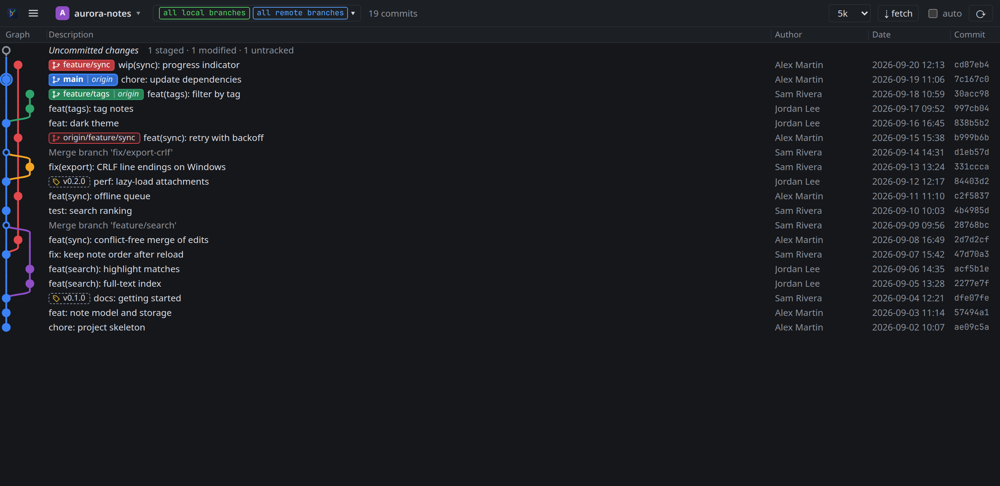
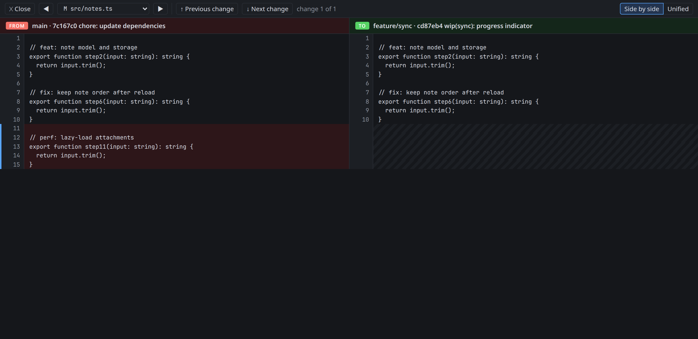

<p align="center"></p>

# BranchSight

A dense git commit graph for Linux, Windows and macOS — one line per commit, about 50 on a screen — filtered to
the branches you pick, with the files and diff of each commit. In the spirit of VS Code's Git Graph, without the
editor.



- **Read history fast**: every local and remote branch by default, a fuzzy branch picker, labels in each lane's
  colour, a limit from 10 commits to all of them.
- **Look inside**: the files and diff of a commit, the comparison of any two commits or branches (`ctrl`+click),
  your uncommitted work split into staged, not staged and untracked.
- **Read a diff properly**: a full-window diff view, *FROM* one side *TO* the other with branch names, whole files
  side by side, next and previous change across every file.
- **Act from the graph**: right-click to check out, merge, rebase, push (normal, with lease or forced), cherry-pick,
  revert, drop or reset, copy a name or a hash, or delete a branch on the remote; anything that rewrites history
  asks first.
- **Always current**: commits, checkouts and file edits made elsewhere show up within five seconds.
- **Your git, your machine**: it runs your own `git`, opens no network port, and changes a repository only when you
  ask.



## Quick install

BranchSight needs `git` on the `PATH`. Set the version once, then pick your system:

```bash
v=0.4.3
```

| System | Desktop app |
|---|---|
| Fedora, RHEL | `sudo dnf install https://github.com/acm363/branchsight/releases/download/v$v/BranchSight-$v-1.x86_64.rpm` |
| Debian, Ubuntu | `curl -LO https://github.com/acm363/branchsight/releases/download/v$v/BranchSight_${v}_amd64.deb && sudo apt install ./BranchSight_${v}_amd64.deb` |
| Any Linux | `curl -L -o BranchSight.AppImage https://github.com/acm363/branchsight/releases/download/v$v/BranchSight_${v}_amd64.AppImage && chmod +x BranchSight.AppImage && ./BranchSight.AppImage` |
| Windows | download `BranchSight_<version>_x64-setup.exe` from [Releases](https://github.com/acm363/branchsight/releases/latest) and run it (More info → Run anyway) |
| macOS | download `BranchSight_<version>_aarch64.dmg` from [Releases](https://github.com/acm363/branchsight/releases/latest), drag it to Applications, right-click → Open the first time |

To serve the page to a browser instead (over SSH, in WSL, in a container), install the `branchsight` command:

```bash
mkdir -p ~/.local/bin
curl -L -o ~/.local/bin/branchsight https://github.com/acm363/branchsight/releases/latest/download/branchsight-cli-linux-x86_64
chmod +x ~/.local/bin/branchsight
branchsight serve --root ~/code        # then open http://localhost:7420
```

Other systems, upgrades and building from source: [install guide](docs/how-to/install.md).

## Documentation

- New here? Take the [first look at a repository](docs/tutorials/first-look.md).
- Getting something done: [compare branches](docs/how-to/compare.md),
  [review uncommitted changes](docs/how-to/review-uncommitted-changes.md),
  [check out and clean up branches](docs/how-to/checkout-and-clean-up.md),
  [use it with WSL, SSH or a container](docs/how-to/use-remotely.md),
  [customise the view](docs/how-to/customise-the-view.md).
- Looking something up: [interface](docs/reference/interface.md), [`branchsight serve`](docs/reference/serve.md),
  [settings and defaults](docs/reference/settings.md).
- Understanding it: [architecture](docs/explanation/architecture.md),
  [what it changes and how it stays safe](docs/explanation/safety.md).

## Development

```bash
scripts/check.sh      # unit and end-to-end tests, graph layout tests, desktop app build
```

| Path | Role |
|---|---|
| `src/git/` | the git commands: `run.rs` starts git, `read.rs` history and status, `diff.rs` changes, `write.rs` actions |
| `src/api.rs` | the routes shared by the app and `serve` |
| `src/http.rs` | the `serve` listener and its loopback and same-site guards |
| `src/projects.rs` | repository discovery |
| `src/web/` | the page: `history/`, `changes/`, `header/`, `actions/`, `shared/`; `history/graph.js` computes the lanes |
| `app/` | the Tauri shell |
| `tests/` | end-to-end tests against throwaway repositories, page logic tests in `tests/js` (`node --test`) |
| `scripts/` | checks, the demo repository and the documentation screenshots |

CI runs the tests on Linux and Windows on every push; pushing a `v*` tag tests on macOS too and drafts a release
with the installers.

## Contributing

Bug reports, ideas and pull requests are welcome: see [CONTRIBUTING.md](CONTRIBUTING.md). Every pull request is
reviewed by the maintainer, [@acm363](https://github.com/acm363), before it lands in `main`.

<a href="https://github.com/acm363/branchsight/graphs/contributors"></a>

## License

[MIT](LICENSE) © 2026 Acm_363 — free to download, use, modify and fork; keep the copyright notice.
