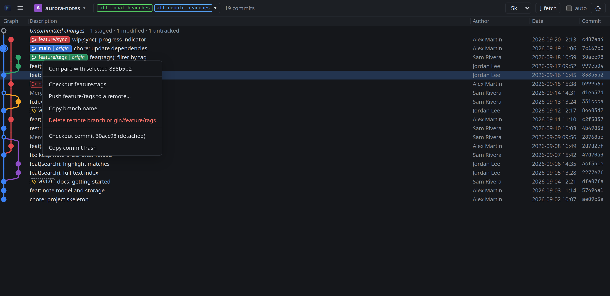

# Check out and clean up branches

Everything here starts with a right-click on a branch label, a tag or a commit row.

## Switch to a branch

Choose **Checkout `<branch>`**.

- On a local branch, BranchSight switches to it.
- On a remote branch such as `origin/feature/sync`, it creates the local `feature/sync` tracking it and switches to
  it. If that local branch already exists, it switches to it as it is, like `git switch`, and tells you when the
  remote branch has commits it lacks: bring them in with **Sync**.

Git refuses when your uncommitted changes would be overwritten; the reason appears at the bottom of the window.

## Look at a tag or an old commit

Choose **Checkout tag `<tag>` (detached)** or **Checkout commit `<hash>` (detached)**. HEAD then points at that
commit without being on a branch, which is how git lets you inspect old states. Check out a branch to leave it.

After any checkout the graph keeps your branch selection and scrolls to the new HEAD.

## Bring a branch and its remote branch back in line

Right-click the local branch or its remote branch. The menu says where they stand and offers what fits:

| They are | The menu offers |
|---|---|
| on the same commit | nothing to do |
| local only behind | **Sync `<branch>` with `origin/<branch>` (n commits to bring in)…** |
| local only ahead | **Push `<branch>` to `origin/<branch>` (n commits to send)…** |
| diverged | the count on each side, then **Sync** (merge or rebase), **Reset `<branch>` to `origin/<branch>`**, which drops its own commits, or **Push `<branch>` over `origin/<branch>`** with force with lease |

The counts are against the last fetch: **⇣ fetch** first to get the latest. A reset keeps uncommitted changes, or
git refuses; the dropped commits stay reachable through `git reflog` for a while.

### Sync

Sync brings the remote branch's commits into your local branch, as `git pull` does, and asks how:

- **Merge** fast-forwards when the local branch has no commits of its own, and otherwise creates a merge commit, as
  `git pull` does;
- **Rebase** replays the local branch's own commits on top of the remote ones;
- **Fast-forward only** refuses when the local branch has commits of its own.

A local branch you are not on, and that only lags behind, is brought up where it is: you stay on your branch. When it
has diverged, BranchSight switches to it first.

## Merge a branch into yours

Choose **Merge `<branch>` into `<current>`…** on a branch, a remote branch, a tag or a commit, then pick how:

- **Fast-forward when possible** moves your branch forward if it has no commits of its own, and otherwise creates a
  merge commit, as `git merge` does;
- **Always create a merge commit** keeps a merge commit even when a fast-forward was possible (`--no-ff`);
- **Squash** stages all of the branch's changes as one, for you to commit (`--squash`).

Tick **Don't commit** to stop before the merge commit and review the result in **Uncommitted changes** first. When
the branches conflict, the merge stops: the conflicted files appear in **Uncommitted changes** marked `U`; resolve
them in your editor and commit, or run `git merge --abort` to go back.

## Push a branch

Choose **Push `<branch>`…**, or **Push `<branch>` to a remote…** when it has no upstream yet. Pick the remote and how
to push:

- **Normal** only adds commits, and is refused when the remote has commits you do not have;
- **Force with lease** overwrites the remote branch unless someone pushed to it since your last fetch;
- **Force** overwrites it whatever it holds, after one more confirmation.

The branch is pushed to the remote branch of the same name, and tracks it from then on, as with `git push -u`. When it
tracked something else, such as the `origin/main` it was started from, the dialog says so before you push.

## Delete a branch on the remote

Choose **Delete remote branch `<remote>/<branch>`**, then confirm. This runs
`git push <remote> --delete <branch>` with your own credentials: the branch disappears for everyone using that
remote, and BranchSight cannot undo it. Your local branch, if any, is kept.

## Copy a name or a hash

**Copy branch name** copies the name without the remote, ready for `git switch`. **Copy commit hash** copies the full
hash; clicking a hash in the Commit column, or pressing `c`, does the same.
