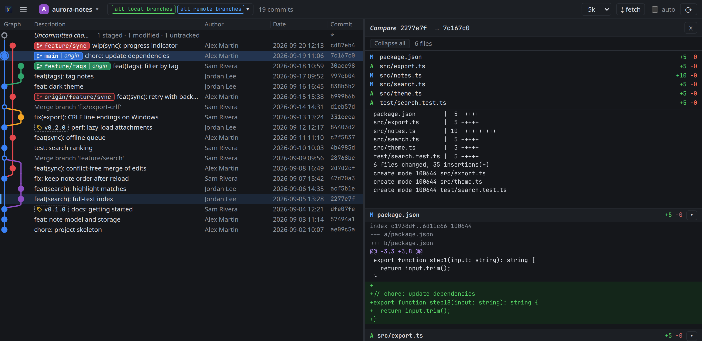

# Compare two branches or commits

Use this to see everything that would land if one branch were merged into another, or what changed between two
releases.

1. Click the first commit, for example the tip of `main`.
2. Hold `ctrl` (`cmd` on macOS) and click the second one, for example the tip of `feature/tags`.

   Or right-click the second commit and choose **Compare with selected**.

The panel shows the diff from the older of the two to the newer, whichever you clicked first. Both rows are
highlighted while the comparison is open.

To compare against a tag, click the commit carrying the tag. To end the comparison, click any commit, press `esc`,
or double-click a row.

The comparison is the result of `git diff <older> <newer>`: the end states of the two commits, whatever happened in
between. To see commit by commit what a branch adds, select only that branch in the branch picker and walk
through it with `↓`.
