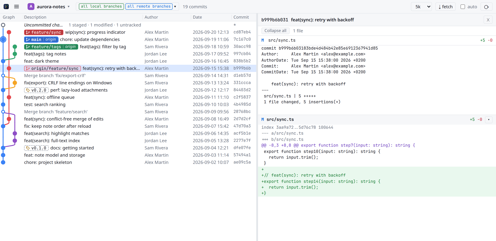

# Customise the view

Each change below is remembered between launches.

| To… | Do this |
|---|---|
| change the text size | ☰ › View › Text size: `−`, `+` or `reset` (10 to 20 px; the graph scales with it) |
| force light or dark | ☰ › View › Theme: `System` follows your desktop, `Light` and `Dark` force it |
| resize a column | drag the edge between two column titles; double-click the edge to reset it |
| show fewer or more commits | the limit selector at the top right: 10 to 20,000, or all |
| hide remote branches or show tags in the picker | the `remotes` and `tags` boxes in the branch picker |
| resize the diff panel | drag its left edge |

Which settings apply to every project and which to one project is listed in the
[settings reference](../reference/settings.md).
