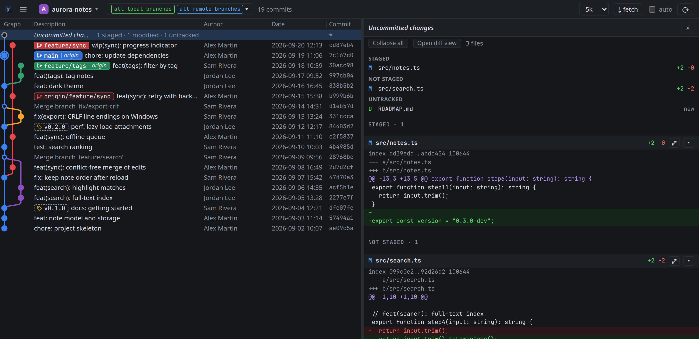

# Review uncommitted changes

When your working copy differs from HEAD, a dashed **Uncommitted changes** row sits at the top of the graph with a
summary such as `1 staged · 2 modified · 1 untracked`.

1. Click the row.
2. Read the three groups in the panel: **Staged** (what the next commit will contain), **Not staged** (edited but
   not added) and **Untracked** (new files git does not follow yet).

To read a file side by side, double-click it in the file list or click its `⤢`: the diff view labels the sides
*HEAD* → *Staged (index)* for staged files, *Staged (index)* → *Working tree* for the others.

The row and the panel refresh on their own within five seconds of a change, including further edits to a file that
was already modified. The row disappears once the working copy is clean.

BranchSight only shows these changes; stage, commit or discard them with git or your editor.

If the row is missing although you have changes, your HEAD is outside the branches you selected: tick
**all local branches** in the branch picker.
