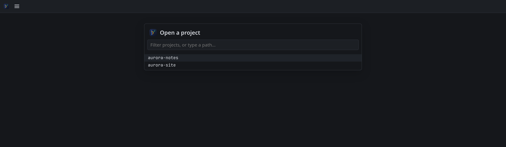
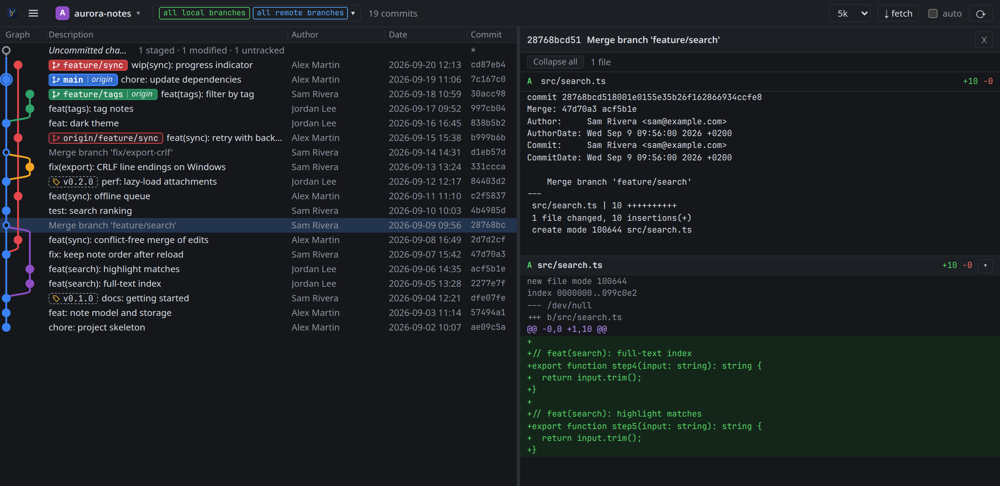

# A first look at a repository

In about ten minutes you will open a repository, read its graph, look inside a commit, compare two commits and
review your uncommitted work. You need BranchSight [installed](../how-to/install.md) and any git repository; the
screenshots use a small demo project called `aurora-notes`.

## 1. Open the project

Start BranchSight. The first time, it shows the project picker: every repository found under your home folder.

Type a few letters of the project's name and press `enter`. Next time, BranchSight reopens this project directly.

## 2. Read the graph

Each line is one commit, newest at the top. The coloured lanes on the left are the history of each branch: a lane
that splits off is a branch being created, a lane that joins back is a merge.

- A **filled label** in a lane's colour is a local branch; when its remote is on the same commit it shows inside the
  label, like `main | origin`.
- An **outlined label** is a remote branch on its own, here `origin/feature/sync`, one commit behind the local one.
- A **dashed label** is a tag, like `v0.2.0`.
- The **ringed dot** is where you are now (HEAD), and the dashed row above it is your uncommitted work.

By default you see every local and remote branch. Click the branch picker next to the project name, untick
**all remote branches**, and only local history remains; tick it again to come back.

## 3. Look inside a commit

Click `Merge branch 'feature/search'`. The panel on the right lists the files the commit changed, then the diff of
each file.

A merge is shown against its first parent, so you see what the merge brought in. Each file header stays pinned
while you scroll its diff; click it to fold the file, or use **Collapse all** at the top. Press `↓` and `↑` to walk
through the commits with the panel open, and double-click a row to close it.

## 4. Compare two commits

With `chore: update dependencies` selected, hold `ctrl` and click `feat(search): full-text index`. The panel now
shows every change between the two commits, with both rows highlighted.

## 5. Review your uncommitted work

Click the dashed **Uncommitted changes** row at the top. The panel splits your work into what is staged, what is
modified but not staged, and new files git does not track yet.

Edit a file in your editor and watch the row and the panel update within five seconds; there is no refresh button
to press.

## Where next

- Before merging a branch, [compare it with its target](../how-to/compare.md).
- Right-click a branch to [check it out or delete it on the remote](../how-to/checkout-and-clean-up.md).
- Every key and menu item is in the [interface reference](../reference/interface.md).
